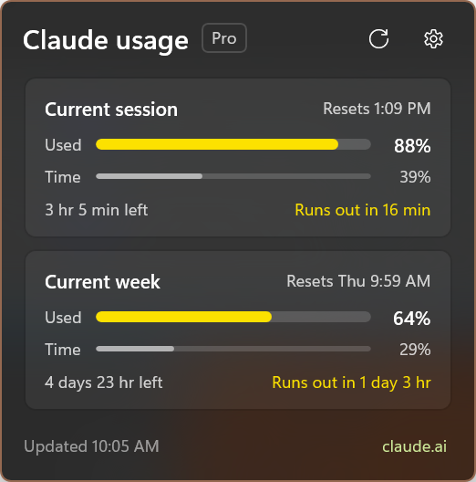

# Trai Usage



Your Claude plan limits in the Windows notification area. Click the tray icon to see how much of the current session and the current week you've used, and how much of each window is left.

Trai Usage is a WinUI 3 app that lives in the tray. It has no main window: the icon opens a small flyout next to it, styled like the shell's own flyouts. It shows the same numbers as Claude Code's `/usage` and claude.ai's usage page, for the Claude account Claude Code is signed in to.

## What it shows

Each limit gets a card with two bars:

- **Used:** how much of the limit you've used.
- **Time:** how much of the limit's window has gone by. A session window is 5 hours from your first message; a week is 7 days.

When the Used bar is longer than the Time bar, you're using the limit faster than it renews, and at that rate it runs out before it resets. The card does that math for you:

- **"On pace for 40%"**: at the rate so far, you'll be around 40% when the window resets.
- **"est. limit in 25 min"** (amber): at the rate so far, you'll hit the limit 25 minutes from now, before the reset.
- **"Limit reached"** (red): the limit is used up until the reset time shown.
- Usage at 80% or more is amber even when it's on pace.

The cards are the current session, the current week across all models, and any per-model weekly limit your plan has (for example "Current week · Sonnet"). Each card also shows when the window resets ("Resets 1:10 PM", "Resets Thu 10:00 AM") and how long that is from now. Countdowns tick while the flyout is open, and the footer says how long ago the numbers were refreshed ("Refreshed 2 minutes ago").

## Using it

- **Left-click** the tray icon to open or close the flyout. Click anywhere else, or press Escape, to dismiss it.
- **Right-click** for Open, Open usage on claude.ai, Settings, and Exit.
- **Hover** the icon for the last numbers it fetched, for example "Session 88% · Week 64%" and when they were updated.
- **Refresh** (the circular arrow) fetches now. Otherwise the flyout refreshes when it opens (if its data is over a minute old) and every 2 minutes while it stays open.
- **Settings** (the gear): Start with Windows, and which Claude account it's reading. Escape or Alt+Left goes back.
- **claude.ai** in the footer opens Claude's own usage page.

Before the first usage report arrives, the tray icon is the app glyph, switching between white and black to match the taskbar's light or dark theme. Once connected, it becomes two vertical bars: session usage on the left and weekly usage on the right, filling from the bottom. They use the flyout's colors (accent, amber when the pace is high, red when the limit runs out early) and follow the taskbar theme. The bars update whenever the flyout refreshes; nothing is fetched while it's hidden.

## Install

Trai Usage isn't in the Microsoft Store yet. Build it from source (below), or install a signed MSIX from a GitHub release when one is published. A sideloaded MSIX needs its signing certificate trusted first; the release notes say how.

Requirements: Windows 10 1809 (build 17763) or later, x64 or ARM64.

## Setup

There's nothing to configure. Trai Usage uses the sign-in that [Claude Code](https://claude.com/claude-code) already has:

1. Install Claude Code and sign in with a Claude Pro, Max, Team, or Enterprise account (`claude`, then follow the prompts).
2. Start Trai Usage.

If Claude Code is set up with an API key instead of a Claude account, there are no plan limits to show, and the flyout asks you to sign in with a Claude account.

## Privacy and footprint

- **What it reads:** Claude Code's sign-in file, `%USERPROFILE%\.claude\.credentials.json` (or `%CLAUDE_CONFIG_DIR%\.credentials.json` when that variable is set). It reads the file fresh for each request and keeps nothing from it but the plan name.
- **What it never does:** write to that file, renew the token, copy it anywhere, or log it. Claude Code owns the sign-in. Its refresh token changes every time it's used, so renewing it from a second app could sign Claude Code out.
- **Network:** one HTTPS request to `api.anthropic.com/api/oauth/usage`, the endpoint behind Claude Code's `/usage`, and only while the flyout is open: when it opens, every 2 minutes while it stays open, and when you press Refresh. Nothing runs in the background while the flyout is closed.
- **Stored:** only whether the app has launched before (in its own app settings). The last usage numbers stay in memory for the tooltip and the next open.
- **Footprint:** a minute after the flyout is dismissed, the window is closed and its memory released, so the idle app is a tray icon and little else.

The usage endpoint is not a documented public API. If Anthropic changes it, the flyout says it can't read the response, and Trai Usage needs an update.

## Build from source

Prerequisites:

- [.NET 10 SDK](https://dotnet.microsoft.com/download)
- The winapp CLI: `winget install Microsoft.WinAppCli`
- Developer Mode turned on (Settings > System > For developers), so the app can be registered with package identity.

From the repository root:

```powershell
winapp run              # build, register, and launch (first run opens the flyout)
winapp run --clean      # reset app data to see the first run again
winapp run -c Release   # the trimmed Release build
```

Tests cover the response parser, the sign-in parser, the pace math, and the text formatting:

```powershell
dotnet test tests/TraiUsage.Tests
```

To release, `build-msix-for-gh.ps1` builds signed x64 and ARM64 MSIX packages and drafts a GitHub release.

## Project layout

| Path | What it holds |
|---|---|
| `App.xaml.cs` | Tray icon, context menu, tooltip, single instance, and the only exit path |
| `Views/TrayFlyoutWindow` | The flyout window: placement next to the tray, fit to content, light dismiss, animation, idle close |
| `Views/FlyoutPage` | The usage cards, loading and error states, polling while visible |
| `Views/SettingsPage` | Start with Windows and the Claude account, swapped into the flyout |
| `Controls/UsageCard` | One limit: the Used and Time bars, reset time, countdown, and pace |
| `Services/ClaudeUsageService.cs` | Reads Claude Code's sign-in and fetches the usage |
| `Usage/` | WinRT-free logic: response and sign-in parsing, pace math, formatting. The tests link these files |
| `tests/TraiUsage.Tests` | MSTest tests for `Usage/` |

## Troubleshooting

- **"Sign in to Claude Code":** there's no Claude sign-in in the credentials file. Run `claude` and sign in.
- **"Claude Code's sign-in has expired":** Claude Code renews its token when you use it. Run any Claude Code command, then press Refresh.
- **"Claude is limiting usage checks":** the endpoint rate-limited the request. The flyout backs off and tries again.
- **The app crashes:** unhandled exceptions are appended to `%TEMP%\TraiUsage-crash.log`.
- **Remove the dev registration:** run `winapp unregister` from the repository root.

## License

MIT, see [LICENSE](LICENSE).

Trai Usage is an independent project and isn't affiliated with or endorsed by Anthropic. Claude and Claude Code are trademarks of Anthropic.
